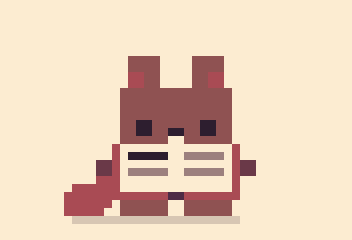
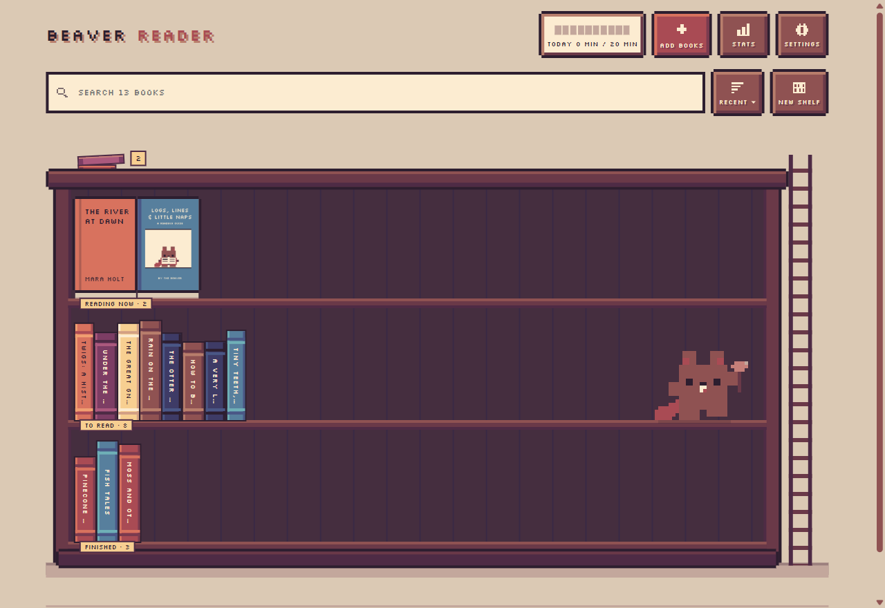
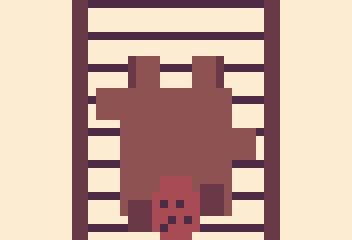
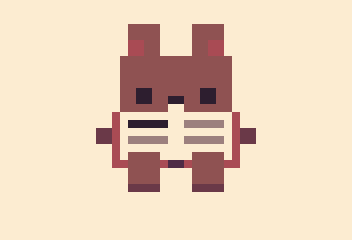
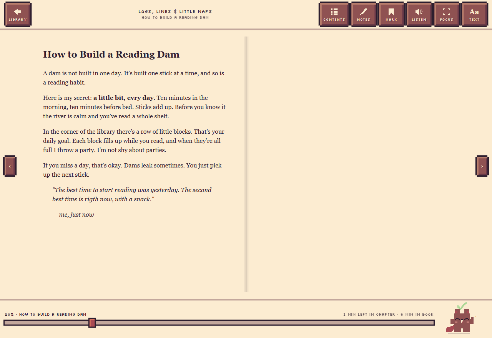
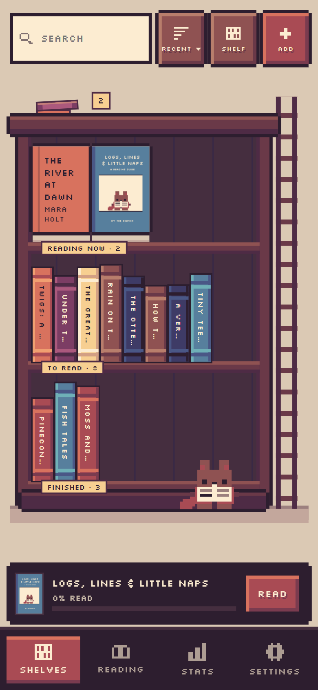

  

<h1 align="center">Beaver Reader</h1>

<b><a href="https://beaver-apps.github.io/reader/">Open Beaver Reader</a></b> · beaver-apps.github.io/reader/

  <b>A tiny pixel beaver who reads with you.</b> 
  EPUB and PDF reader · your own library and shelves · highlights and notes · read aloud · reading stats and streaks

  

---

## Hi, I'm the beaver :)

You might know me from Beaver Focus. This is my other job: I'm the librarian. Bring me your EPUBs and PDFs and
I'll put them on the bookcase for you. I climb all over it all day: up the ladder, dusting, sitting on the shelfs.
When you open a book I sit rigth down beside you and read my own littel book while you read yours.
When you turn a page, I turn mine. Reading is my favrite thing to do togehter, becuase evry book is better with a buddy.

## What I do

<table>
  <tr>
    <td align="center"> <b>Read along</b> right under your page</td>
    <td align="center"> <b>Turn the page</b> when you turn yours</td>
    <td align="center"> <b>Tidy the shelves</b> one book at a time</td>
  </tr>
  <tr>
    <td align="center"> <b>Celebrate</b> finished books and daily goals</td>
    <td align="center"> <b>Nap</b> if you wander off I get sleepey</td>
    <td align="center"> <b>Climb the ladder</b> all the way to the top</td>
  </tr>
  <tr>
    <td align="center"> <b>Dust the shelves</b> a tidy bookcase is a happy bookcase</td>
    <td align="center"> <b>Sit on a shelf</b> and read, legs dangling</td>
    <td align="center"> <b>Hide removed books</b> behind the bookcase, just in case</td>
  </tr>
</table>

## Everything on the shelf

### Your library

- **Add books** with the button, or drag and drop EPUB and PDF files anywhere on the library.
- **A pixel bookcase**: Reading now faces out on the top shelf with your progress, then rows of spines for
  **To read**, **Finished** and **your own shelves** (a book can sit on as many as you like; **+ New shelf** adds a row).
  Books move to Reading when you open them, and to Finished when you reach the end.
- **Tap a spine** and the book slides out with its cover, how far you are, and **Read** / **Details**.
- **Search** titles and authors as you type: matching books light up and stick out, the rest go dim, and typos are fine
  ("hobit" finds *The Hobbit*).
- **Sort** by recent, title or author, or **drag books** into your own order (**Mine**). Hold a moment on a phone, then drag.
  Drop a book on another shelf to move it there, like from To read to Finished.
- **My own book is waiting for you.** The first time you open the app, *Logs, Lines & Little Naps* by The Beaver
  is already on the shelf: six short chapters about reading habits, highlights, shelves and sleepy eyes. Removed it?
  Settings puts it back.
- **Covers** come from the book itself, and the **spine takes the cover's colour** (the closest one on the palette).
  Books without one get a coloured cover with their title on it.
- **The beaver lives on the bookcase**: he climbs the ladder, dusts, reads or naps on a shelf edge, stacks books on the floor. Click him and he waves.
- **Sound effects**: little 8-bit blips for page turns, books on the shelf and the beaver (squeaks, sneezes, cheers), made on the spot with no sound files, a little different each time, and a soft wooden clonk on buttons. **Settings → Fun → Sound effects**: Off, Quiet or Normal.
- **Stay away two days and it gets dusty** (a week: cobwebs). He sneezes, then dusts the top and every shelf, top to bottom.
- **Book details**: rename the title and author, change the status, pick shelves or make a new one,
  or **remove from this device** (when sync is on). **Previous** / **Next**, the arrow keys or a swipe of the card go
  through every book on the bookcase, in its order.
- **Remove a book** and I carry it off: down the shelf, up the ladder, and over the top. It lands **behind the bookcase**,
  where you can see the pile peeking out. Tap the pile (or **Settings → Behind the bookcase**) to **put a book back**,
  with your place, highlights and notes, or to **delete it for good**.

  

### The reader

- **Pages or scroll** for EPUBs. Turn pages with the **scroll wheel**, by **clicking the left or right side** of the page,
  with any **arrow key** or Page Up / Page Down, the arrows on screen, or a swipe. A slider at the bottom jumps anywhere in the book.
- **A pixel page flip**: one leaf lifts and folds over in chunky steps (on a two-page spread, only the right page turns). On a phone, drag the page slowly and it lifts with your
  finger. Rather have none? **Page turn → Instant** in the reading settings (Aa → Page).
- **Full screen on phones**: tap the middle of the page and the bars slide away (they tuck themselves away when you turn a page too).
- **Focus mode on computers**: the corners button (or **F**) goes full screen with nothing but the page. Move the mouse to
  the top or bottom edge for the bars; **F** or **Esc** leaves.
- **Contents** from the book's own table of contents (or a PDF's outline), with **search inside the book** at the top.
  Typos are fine, and the place you jump to lights up for a moment.
- **Two pages side by side** on big screens in landscape, like an open book (or always one, if you like).
- **Time left** at the bottom: "6 min left in chapter · 2 h in book", worked out from how fast *you* read.
- **Bookmarks** with one tap (a little red ribbon hangs from the page), and a **Notes** panel that lists your bookmarks and highlights in book order.
- **Highlights** in 5 palette colours (yellow, peach, green, blue and pink). Select some text, pick a colour,
  and add a note if you like. You can also just copy the text.
- **Read aloud** with your browser's own voices, sentence by sentence. Pick the voice and the speed
  (slow, normal, fast or faster). In EPUBs the sentence being read lights up and the page follows along.
  Turn the page yourself and I start reading from there.
- **Reading settings** (the **Aa** button), in four tabs with a **live preview of your own page** at the top:
  **Text** (size slider, serif, sans or the book's own font, tight, cozy or airy spacing, narrow, normal or wide margins,
  ragged or justified lines), **Page** (paper, texture, page turn, pages or scroll, spreads), **Night** (bedtime and the
  sleep timer) and **Voice** (pick a voice and **try it**, and the speed). Each tab can be reset.
- **Look up a word**: select it and tap **Look up** for a short definition from Wiktionary, while I hunt for it in my detective cap.
- **Bedtime**: a warmer, dimmer page after 9 or 10 pm (or right now), and a **sleep timer** for reading aloud.
- **Paper colours**: Cream, Sand, Dusk or Night, or Auto to follow light and dark, with an optional **paper texture**.
- **PDFs** fit the whole page or the width.

### Stats

- **Minutes read** today and over the last 7 days, and **pages turned** today.
- A **daily goal** (20 minutes to start; change it in Settings) and a **streak** of days in a row you met it.
- **Books finished this year** and a **14-day chart** with your goal line.
- Time only counts while a book is open on screen and you've turned a page, scrolled or tapped in the last 2 minutes.
- **Reset stats** (in Settings, under the daily goal) starts them over; it asks first. Your books, progress and goal stay, and the reset reaches synced devices too.

### And also

- **Languages.** I speak English, Svenska, Dansk, Norsk, Suomi, Deutsch, Español, Français, 中文 and 日本語. The first time I
  follow your device; **Settings → Look → Language** changes it. My own book comes in your language too and follows you when you switch, in the same chapter (yes, with my
  typos in every one of them :P), and Chinese and Japanese get a pixel font of their own.
- **Phone, tablet or computer.** Install it to your home screen or desktop, and it works offline. Phones get their own
  touch layout; computers keep the computer layout (with pixel tooltips) however narrow the window.

  

  On a phone you get tabs at the bottom (Shelves, Reading, Stats, Settings), a keep-reading bar for the book
  you're in, and full-screen reading: tap the middle of the page and the bars go away. Installed, I fill the whole
  screen, notch and all, and the **back button** steps out of whatever is open, one thing at a time.
- **A quick tour** the first time you come in: I show you the bookcase, adding books, the shelves, your stats and
  Settings. **Settings → Quick tour** shows it again.
- **Light and dark** (or Auto), and calmer motion when your device asks for reduced motion.
- **Sync between devices** through a private GitHub repo, if you want it (see below).

### Little tricks

| Do this | And I… |
|---|---|
| Turn a page | turn mine too |
| Click or tap me in the reader | turn my page, just for fun |
| Click or tap me in the library | wave at you |
| Pick me up in the library | dangle and kick, then drop onto the shelf below |
| Shake your phone on the bookcase | the books fall off the shelves and I go flying, then I tidy up behind a curtain (I'm very tired after) |
| Drop a pile of books on the library | shelve them all |
| Highlight something | do a happy bounce |
| Remove a book | carry it up the ladder and hide it behind the bookcase (tap the pile to get it back) |
| Finish a chapter | give you a thumbs up (I allways do) |
| Turn to an exciting page | gasp! |
| Read past bedtime | yawn (sorry, it's contagious) |
| Finish a book, or reach your daily goal | throw a party \o/ |
| Take a book straight back out of Finished | sigh. A big one. (Did you really finish it?) |
| Leave the book alone for 3 minutes | take a nap (not while I'm reading aloud) |
| Come back | wake up and keep reading |

## Your data stays with you

Everything is saved in your own browser: the book files and covers in its database, and your library, progress,
bookmarks, highlights, notes, stats and settings next to them. Nothing is sent anywhere unless you turn on sync or look up a word.

**Look up** sends only the word you picked to [Wiktionary](https://en.wiktionary.org) to fetch its definition, and only when you tap it.

Read aloud uses the voices your browser and system offer. Some browsers also offer online voices, which may send the
text to the browser's maker; choose a local voice if that matters to you.

### Sync (optional)

Two ways, pick one in **Settings → Sync between devices**:

- **Google Drive** (the easy one, in the online app): sign in with Google and your library goes into a **Beaver Reader**
  folder in your Drive. Beaver Reader can only see the files it makes there. Google asks you to sign in again now and then.
- **GitHub** (for people who like GitHub): a private repo, set up like this:

Sync uses a **private GitHub repo that only holds your library**:

- `library.json`: every book's details, status, shelves, progress, bookmarks, highlights and notes, plus your stats and daily goal
- `books/`: the book files themselves, uploaded once and downloaded on the devices that open them

To set it up:

1. Make an empty **private** repo on GitHub (for example `beaver-reader-library`).
2. Make a **fine-grained personal access token** for **only that repo**, with **Contents: Read and write**.
3. Open **Settings → Sync between devices**, paste the repo (`you/beaver-reader-library`) and the token, and press **Connect**.

The token is kept in this browser only. Changes sync a few seconds after you make them, when you come back to the app,
or when you press **Sync now**. Books that are only in the repo show a **CLOUD** badge and download when you open them.
Books bigger than 45 MB stay on the device you added them on. Your theme and text settings stay on each device.
**Disconnect** removes the token from the browser.

## Versions

Every update has a name. You can see them all in **Settings → What's new**.
The newest is **v1.25.3 "Lights Down"**.

## About this repo

This repo holds the ready-to-use Beaver Reader that runs at https://beaver-apps.github.io/reader/ (just the built files).
The source code is private for now.

## License

Free to use, change and share for **noncommercial** purposes only, under the
[PolyForm Noncommercial License 1.0.0](LICENSE.md). Nobody may sell it or use it to make money.

Required Notice: Copyright 2026 BwunLevain (https://github.com/BwunLevain)

The pixel font Silkscreen is by The Silkscreen Project Authors and keeps its own
license, the [SIL Open Font License 1.1](fonts/OFL.txt).

 Now go find a cozy spot. I saved you a page.

